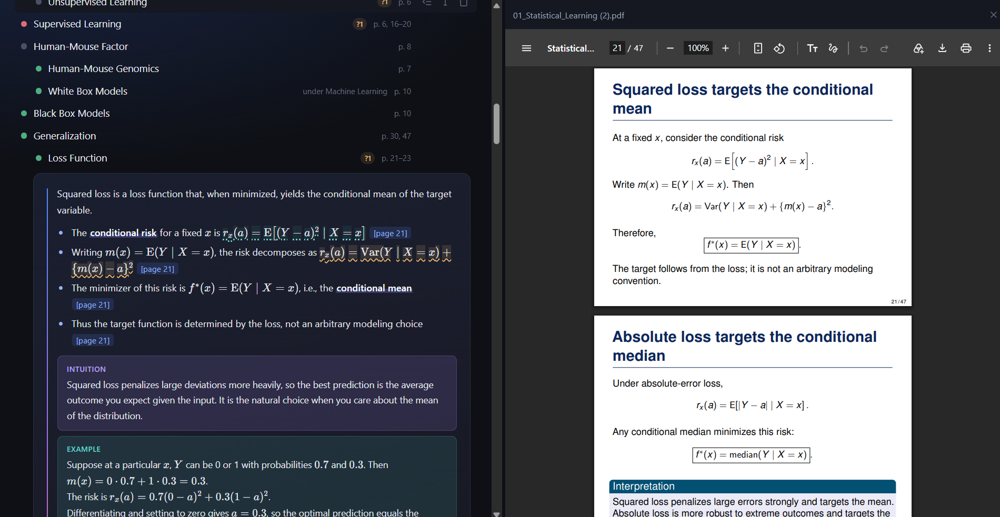
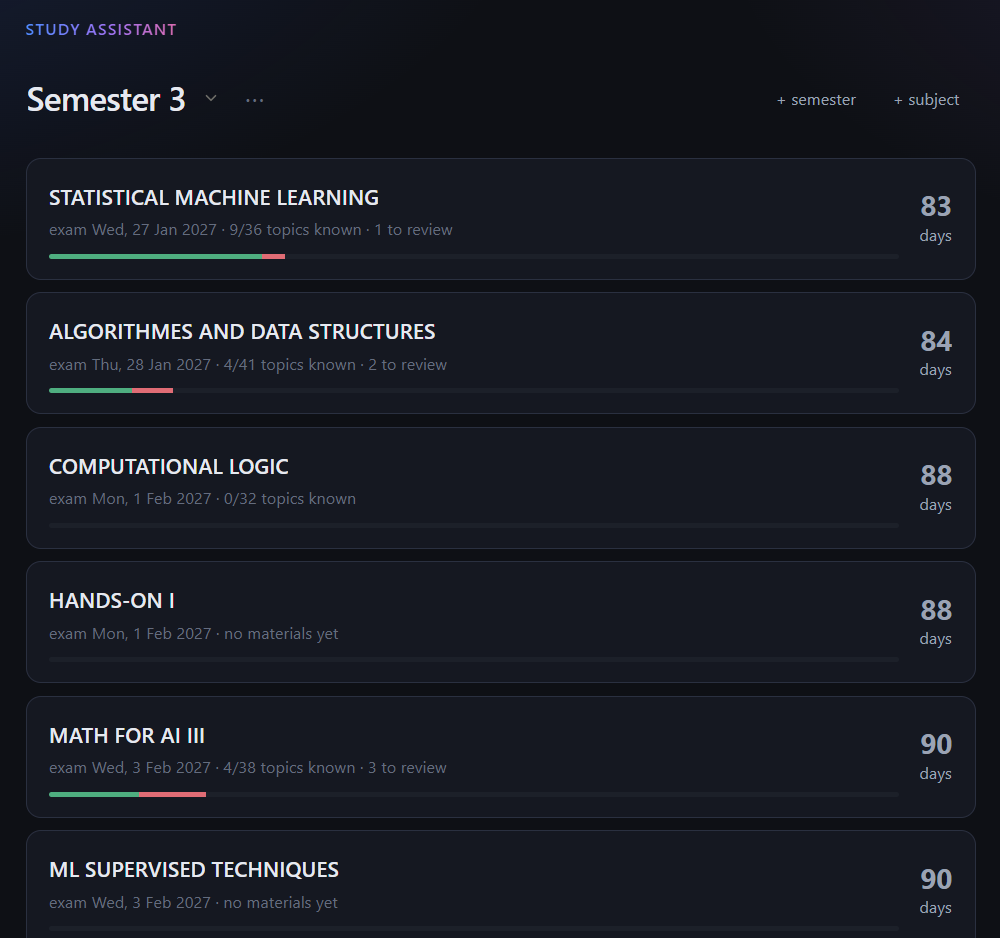
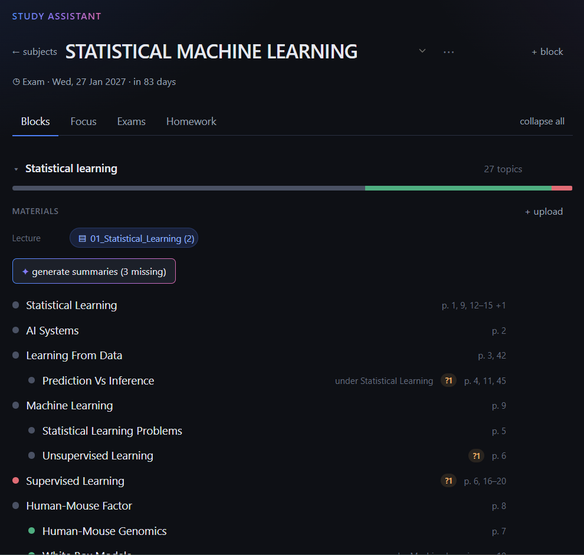
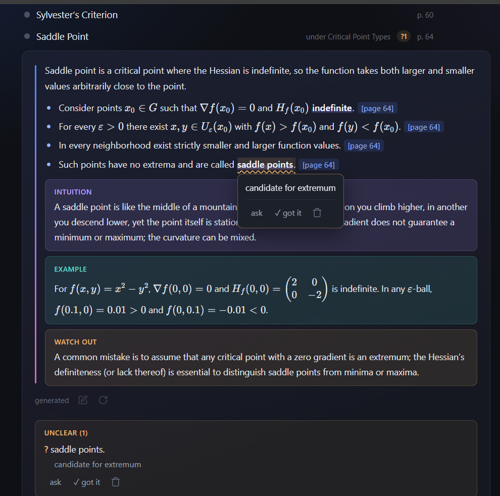
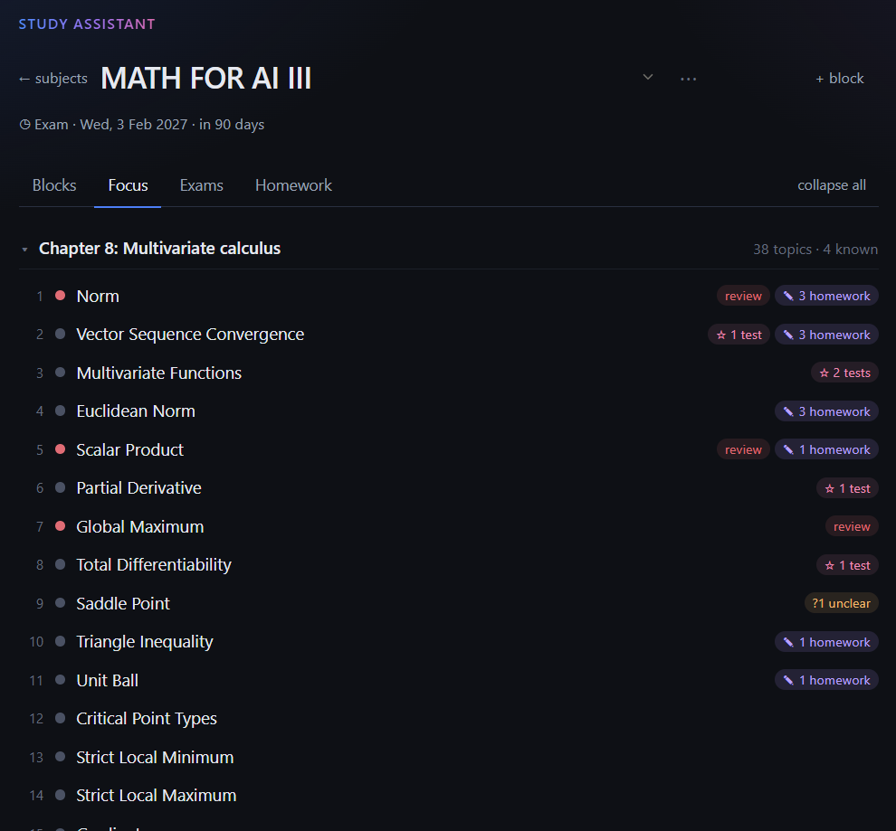
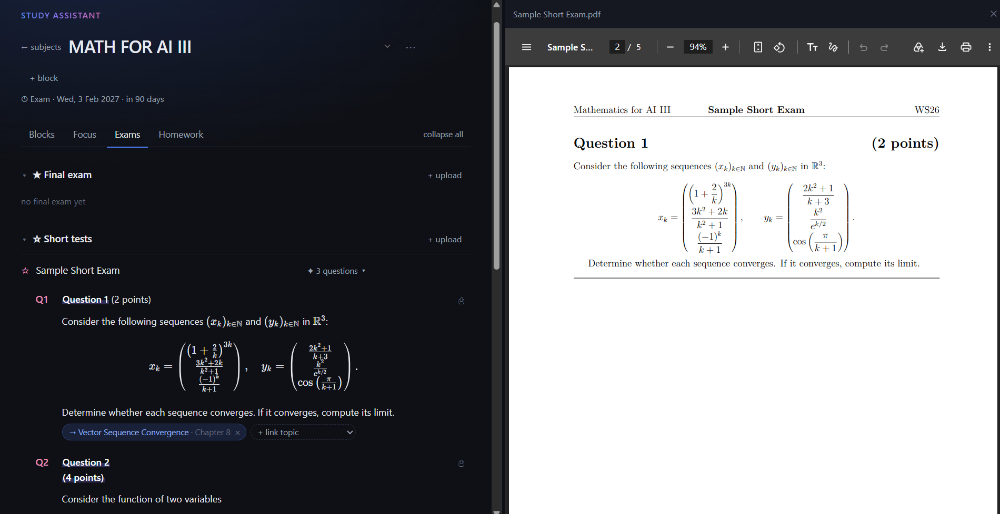

# study-assistant

**One place for a whole course — lectures, homework, past exams and your own notes — linked through shared topics.**

Not another LLM chat over your PDFs. There is a model inside: it sorts the
material into topics, writes summaries and answers questions, always citing the
slide. But what you work with is the structure, not a chat window.



## Why

During a semester everything ends up scattered: slides in one folder, homework
in another, past exams somewhere else, notes in notebooks, explanations lost in
dozens of chats. Before a lecture there is no quick way to see what it covers.
Before an exam there is no way to tell which topics actually get asked and which
ones you still don't get.

## What it gives you

- **Before a lecture**: skim the block's topics in two minutes, each with a
  short summary and its slides.
- **While studying**: ask a question and get an answer built only from your
  slides, with `[page N]` links that open the slide next to it.
- **During the semester**: mark topics as known or needing review, write notes
  right on the text, flag what's unclear. Progress per block is always in front
  of you.
- **After homework**: upload your solution, even as photos of handwritten
  pages, and see which topics each task practised.
- **Before the exam**: Focus ranks topics by how often they come up in past
  exams and homework, and by how well you know them. One click shows the actual
  questions behind each reason.

Built for my own courses at JKU Linz.

## A tour

**Home.** Subjects of the current semester, ordered by the nearest exam, with
days left, how many topics you already know and how many need review.



**Blocks.** One block per lecture unit: its files and its topic tree, ordered as
in the slides, with the pages each topic covers. Open a topic for its summary,
your notes and unclear places. Drag a topic to regroup it.



Select text in a summary to mark it as unclear or attach a note; hovering a
marked place shows the note and lets you ask about it or mark it understood.



**Focus.** What to study next, block by block, with the reasons spelled out:
★ asked in the final, ✎ practised in homework, ? still unclear. Each reason
opens what is behind it. The order comes from a priority formula, see
[How it works](#how-it-works).



**Exams & Homework.** Past exams and homework are split into questions and tasks
and linked to topics. *Most asked* shows which topics come up again and again.
A wrong link is removed with ×, a missing one added by hand; links added by hand
to a numbered question survive a new analysis.



Uploads take PDFs, photos (several photos become one document, a page each) and
code or Markdown files, which are kept as they are and shown with highlighting.

## How it works

```
upload ──► pages (one chunk per slide; photo-only pages read by a vision model first)
             │
             ├─► topics      small LLM, batched, reuses the subject's existing topic names
             ├─► embeddings  bge-small, locally, 384 dims → pgvector + HNSW
             ├─► hierarchy   LLM, one two-level tree per block
             └─► vision      background queue: slides with formulas or diagrams are
                             re-read, formulas become LaTeX, figures get a text description

exam / homework ──► questions & tasks ──► linked to topics ──► Focus priority
```

- **Answers and summaries** get only the retrieved slides and must cite pages;
  when the slides don't answer the question, the model says so. Summaries are
  written on request, not for every topic up front.
- **Focus priority** is a weighted sum per topic: final exam question ×3, test
  question ×2, open unclear place ×2, status *review* ×2, homework task ×1, note
  marked *come back to this* ×1, plus the topic's share of the lecture. The
  weights are in one table in the code and easy to argue with.
- **Processing is a job queue.** One lecture per subject at a time, since topic
  extraction reuses names already in the subject. The page shows the current
  stage, and jobs interrupted by a restart are marked as failed instead of
  hanging.

## Design decisions

**Topics belong to the subject; blocks only group files.** A topic that shows up
in a lecture, a homework sheet and a past exam has to be one row. Otherwise
marking it *known* in one place leaves it still marked new in the others, and
the priority signal falls apart. Cost: a topic has only one parent (see
Limitations).

**Status is set by hand, never inferred.** Opening a topic is not understanding
it. A progress bar built from clicks looks informative and is wrong, which is
worse than having none.

**Topics follow slide order, not weight.** Weight is already visible; the order
of the lecture exists nowhere else.

**Your edits win.** Once a generated summary is edited by hand, regeneration
skips it, and the API reports that it did, so the protection is never a silent
no-op.

**Spend tokens only where they pay off.** Embeddings run locally, so uploading
and searching cost nothing. Topics, summaries and exam analysis use a small
model; the large one only answers your questions in Ask. The vision model sees
only the pages that need it: formulas, diagrams, photos. The whole project runs
on Groq's free tier.

**Slow work happens after the upload, not during it.** Topics appear as soon as
the text is read. Re-reading formula and diagram slides with the vision model
runs in a background queue, and the block shows its progress. Photo-only pages
are the exception: they have no text at all, so they are read first.

**Homework is linked by its solution, not its statement.** "Prove the following"
says little; the proof shows which topics the task actually practises.

**Several photos become one document.** A handwritten solution shot as five
photos is one file with five pages, so page links, the viewer and task splitting
work exactly as for a lecture PDF.

**Unclear and "come back to this" are different signals.** *Unclear* means I
don't get it yet, so it weighs more in Focus and can be resolved. *Come back to
this* means I understood it but want another look before the exam.

## What I measured

**Chunking.** The first test lecture, 59 pages, became 47 chunks (one per slide,
footers removed), 15 of them flagged weak: almost no text, mostly diagrams.
Today the database holds 17 lectures and 927 pages. The vision pass has re-read
385 of them, and only 11 are still weak.

**The first weak-slide rule was wrong, and retrieval showed it.** On *"how do I
add an element"*, the three best-ranked slides were all flagged weak (178–276
chars, distance 0.379–0.384) and outranked the regular ones (0.413–0.438).
Short did not mean useless: the slides left out of the topic tree were exactly
the ones search found most relevant.
*Then:* a slide is now weak only if it is short **and** mostly a drawing or a
picture. Weak slides are re-read by the vision model, get a text description,
lose the flag and are linked to the nearest topics. *Still open:* a proper
retrieval benchmark (recall@k) to tune this against numbers instead of single
queries.

**Root-causing `json_validate_failed` on Groq.** Building the hierarchy for 11
topics worked; for 26 it failed three times in a row. Two earlier theories were
wrong. The cause: `gpt-oss` is a reasoning model, its reasoning tokens count
against `max_completion_tokens`, and the default 1024 ran out mid-JSON. With
4096, the same input passed on the first try.

**Topics shared between blocks: rare at first, then not.** On the first two
lectures, 1 of 23 topics appeared in both. With 17 lectures it is 35 of 209
(17%). That is the case for keeping topics per subject, not per block.

**Over-fragmentation.** 81 of 209 topics come from a single slide. Some are
genuinely small, a single definition or formula; others are fragments of
definition-per-slide lectures that should be merged, and a one-slide topic gets
a thin summary. *Still open.*

**Exam analysis on three real past exams.** Algorithms and Data Structures:
43 pages, 35 of them screenshots with no text layer, read by the vision model.
32 questions came out. 12 are linked to a topic; the other 20 are about graphs,
flows, community analysis and minimax, which the lectures uploaded so far (the
semester has just started) do not cover yet, and they stay unlinked instead of
being forced onto the nearest topic.
Two failures found on the way: a page that ended one question and started the
next was glued into one question, so Dijkstra carried the topics of an AVL
task; and a minimax question was linked to *Tree* because of the shared word.
*Then:* the prompt now says that a new heading always starts a new question and
that a shared word is not a reason to link; the re-run split the glued
questions and dropped the false link.

## Limitations

- **One parent per topic.** When two blocks disagree about where a topic
  belongs, the last build wins.
- **Exam questions are linked when they are analysed.** Lectures uploaded later
  need the exam to be analysed again.
- **Summaries are not refreshed** when the background vision pass later
  replaces a slide's text (formulas as LaTeX, figure descriptions). A summary
  written before that was made from the raw text.
- **Groq's free tier sets the pace.** The vision model reads roughly 80 pages a
  day; past that, the queue and exam analysis wait for the limit to refill.
- **Network errors skip pages.** After a few failed retries an exam page is left
  out and reported in the analysis result, not retried later.
- **Single user, local.** No accounts and no sync; tested on Windows.
- **No automated tests yet.**

## Next

- Tests for the parts that are pure logic: page ranges, image-to-PDF, the weak
  slide rule, the priority formula
- *Not covered yet*: exam questions with no topic in your materials, a map of
  what the semester still has in store
- Re-linking exam questions automatically when a new lecture arrives
- Flagging a summary as stale when its slides were re-read
- Corrections that teach: fix a misread symbol once, and the fix goes into the
  prompt next time
- A retrieval benchmark (recall@k, MRR) before any tuning of search

## Running locally

Requires Docker and Python (developed on 3.14).

```bash
cp .env.example .env            # fill in the database credentials and GROQ_API_KEY
docker compose up -d            # Postgres 16 with pgvector on port 5433
python -m venv .venv
source .venv/bin/activate       # Windows: .venv\Scripts\Activate.ps1
pip install -r requirements.txt
docker exec -i study-assistant-db psql -U studyuser -d studyassistant < schema.sql
uvicorn main:app --reload
```

Open http://127.0.0.1:8000/app/. On Windows, `relaunch.ps1` does all of the
above after the first setup: starts Docker Desktop and the database, waits for
it, opens the browser and runs the server.

## How it was built

Built with Claude Code as a pair programmer. The product decisions, the data
model and the evaluation above are mine; the code was written together and
reviewed change by change.
